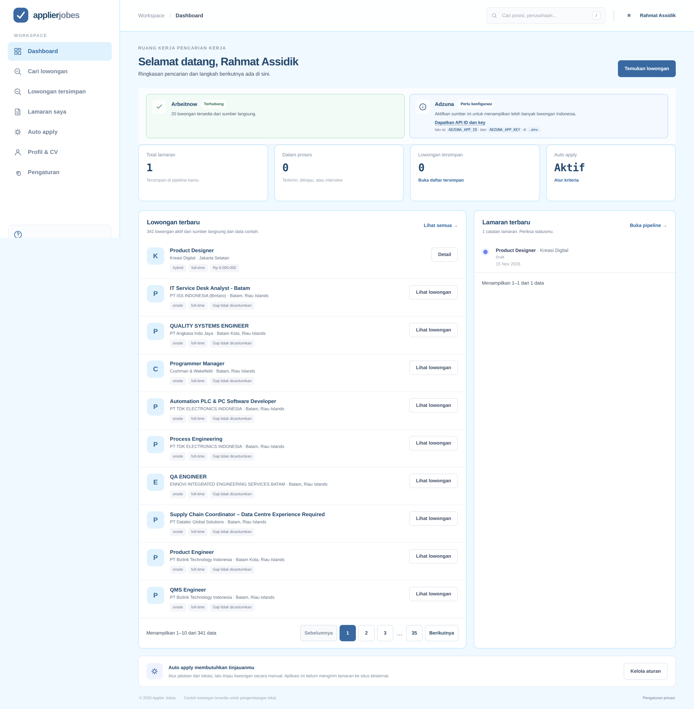

# Applier Jobes


Applier Jobes adalah aplikasi web pencarian kerja dengan dashboard, halaman terpisah untuk setiap menu, autentikasi pengguna, dan backend Express yang menyimpan data serta sesi di MySQL/MariaDB.

> **Penting:** Applier Jobes mengambil lowongan publik dari API sumber dengan atribusi dan tautan ke situs asli. Data lowongan contoh lokal tetap tersedia. Auto apply mencocokkan dan menyiapkan draft; pengiriman tetap dilakukan manual oleh pengguna pada situs perusahaan.

## Pratinjau aplikasi

Berikut screenshot dashboard Applier Jobes dari aplikasi yang berjalan.



## Fitur yang tersedia

- Halaman login dan registrasi; setiap pengguna memiliki data terpisah.
- Dashboard ringkasan lamaran, lowongan tersimpan, dan aturan pencarian.
- Pagination 10 data per halaman pada daftar dashboard, pencarian lowongan, simpanan, lamaran, dan kecocokan auto apply; filter pencarian tetap aktif saat berpindah halaman.
- Sinkronisasi lowongan langsung dari API publik Arbeitnow; Adzuna dapat diaktifkan dengan API ID/key.
- Impor maksimal 50 lowongan yang sudah dimuat pada halaman aktif melalui ekstensi browser, dengan pratinjau dan konfirmasi pengguna.
- Pencarian/filter berdasarkan kata kunci, lokasi, dan mode kerja; setiap listing memiliki atribusi dan tautan sumber.
- Simpan/hapus lowongan dan catat lamaran sebagai draft.
- Pipeline lamaran dengan halaman tinjauan, tautan formulir pemberi kerja, pembaruan status, dan riwayat perubahan.
- Asisten apply terpandu: rekomendasi berdasar kriteria, draft lamaran, checklist profil/CV, tautan ke formulir perusahaan, dan pencatatan status setelah pengguna mengirim sendiri. Kuota draft dapat diatur per minggu; tidak ada pengiriman otomatis ke situs eksternal.
- Profil kandidat, unggah CV PDF privat (maks. 5 MB), unduh/hapus CV, dan ganti kata sandi.
- Logout yang menghapus sesi MySQL.
- Toast feedback untuk aksi formulir: status proses, hasil berhasil/gagal, dapat ditutup, dan dapat diumumkan screen reader.
- Navigasi mobile yang bisa ditutup dengan tombol, backdrop, atau tombol `Escape`.

## Kebutuhan

- Node.js 18+ dan npm.
- MySQL 8+ atau MariaDB 10.4+.
- Akun database untuk aplikasi.

## Menjalankan lokal

### 1. Pasang dependensi

```bash
npm install
```

### 2. Siapkan MySQL/MariaDB

Pastikan layanan MySQL/MariaDB aktif. Jika menggunakan XAMPP Linux yang terpasang di `/opt/lampp`:

```bash
sudo /opt/lampp/lampp startmysql
```

Import schema dan data lowongan contoh menggunakan akun administrator database:

```bash
/opt/lampp/bin/mysql -u root -p < database/schema.sql
```

Jika server lokal tidak memakai kata sandi root, hilangkan `-p`. Untuk instalasi MySQL biasa, gunakan perintah `mysql` yang tersedia di `PATH`.

Jika database Applier Jobes sudah ada dari versi sebelumnya, **jangan impor schema baru sebagai pengganti migrasi**. Jalankan migrasi satu kali setelah backup:

```bash
/opt/lampp/bin/mysql -u root applier_jobes < migrations/001_live_jobs_and_cv.sql
```

Tambahkan `-p` jika akun root meminta password.

Buat akun khusus aplikasi dengan kata sandi yang kuat. Contoh untuk pengembangan lokal:

```sql
CREATE USER 'applier_app'@'127.0.0.1' IDENTIFIED BY 'GANTI_DENGAN_KATA_SANDI_KUAT';
GRANT SELECT, INSERT, UPDATE, DELETE ON applier_jobes.* TO 'applier_app'@'127.0.0.1';
```

Jalankan SQL tersebut pada klien MySQL sebagai administrator. Sesuaikan user host dengan `DB_HOST` yang dipakai aplikasi. Jangan gunakan akun root untuk menjalankan web app. Untuk produksi, sediakan tabel sesi pada proses deployment/migrasi dan kurangi hak `CREATE`, `INDEX`, serta `ALTER` dari akun runtime.

### 3. Konfigurasi environment

```bash
cp .env.example .env
```

Edit `.env` dengan kredensial database yang dibuat di atas. Buat nilai sesi unik:

```bash
openssl rand -hex 48
```

Salin hasilnya ke `SESSION_SECRET`. File `.env` diabaikan Git; jangan commit password atau secret.

Untuk instalasi XAMPP lokal yang memakai akun bawaan `root` tanpa password, konfigurasi pengembangan dapat menggunakan `DB_USER=root` dan `DB_PASSWORD=` (kosong). `SESSION_SECRET` bukan kredensial MySQL; isi dengan nilai acak dari perintah di atas. Penggunaan akun `root` tanpa password hanya untuk komputer lokal, bukan deployment atau server yang dapat diakses jaringan.

Untuk lowongan Indonesia dari Adzuna, daftar di [portal developer Adzuna](https://developer.adzuna.com/overview), lalu isi `ADZUNA_APP_ID` dan `ADZUNA_APP_KEY` pada `.env`. Tanpa key, aplikasi tetap menampilkan lowongan dari sumber publik lain dan memberi tahu bahwa Adzuna belum dikonfigurasi. Jangan kirim API key melalui chat atau simpan di Git.

Variabel utama:

| Variabel | Contoh / kegunaan |
|---|---|
| `PORT` | `3000` |
| `DB_HOST` | `127.0.0.1` |
| `DB_PORT` | `3306` |
| `DB_NAME` | `applier_jobes` |
| `DB_USER` / `DB_PASSWORD` | Akun khusus aplikasi |
| `SESSION_SECRET` | Secret acak untuk cookie sesi |
| `NODE_ENV` | Gunakan `production` saat deployment HTTPS |
| `TRUST_PROXY` | `true` hanya jika ada reverse proxy tepercaya |
| `ADZUNA_APP_ID` / `ADZUNA_APP_KEY` | Opsional, untuk API lowongan Adzuna |
| `ADZUNA_COUNTRY` / `ADZUNA_LOCATION` | Kode negara dan lokasi pencarian Adzuna, default `id` / `Indonesia` |

### 4. Jalankan server

Untuk pengembangan:

```bash
npm run dev
```

Untuk menjalankan server:

```bash
npm start
```

Bila terminal menampilkan `Applier Jobes is listening on port 3000`, server sudah berjalan. Biarkan terminal itu tetap terbuka, lalu buka [http://localhost:3000](http://localhost:3000) dan pilih **Buat akun**. Tidak ada akun demo atau kata sandi bawaan.

Jika halaman menampilkan pesan bahwa database tidak tersedia, server web tetap berjalan tetapi MySQL belum tersambung. Pastikan MySQL/MariaDB hidup, schema sudah diimpor, dan nilai `DB_*` di `.env` sesuai. Periksa koneksi backend dan database di [http://localhost:3000/health](http://localhost:3000/health). Respons sehat:

```json
{"status":"ok","database":"connected"}
```

### 5. Pasang ekstensi impor lowongan

Ekstensi membaca metadata `JobPosting` serta kartu lowongan yang sudah dimuat dan terlihat di halaman aktif setelah pengguna menekan **Pindai halaman ini**. Pada JobStreet, filter pencarian terlebih dahulu lalu pindai halaman hasil tersebut. Maksimal 50 lowongan dapat dikirim dalam satu impor. Ekstensi tidak menggulir untuk memicu pemuatan lanjutan, membuka hasil, mengubah filter, atau berpindah ke halaman berikutnya. Situs harus mengizinkan penggunaan datanya; ekstensi tidak melewati login, CAPTCHA, atau pembatasan akses.

1. Pastikan Applier Jobes sudah berjalan dan kamu sudah masuk, misalnya di `http://localhost:3000`.
2. Buka halaman ekstensi browser:
   - Chrome: `chrome://extensions`
   - Brave: `brave://extensions`
   - Edge: `edge://extensions`
   - Firefox: `about:debugging#/runtime/this-firefox`
3. Aktifkan **Developer mode** pada browser Chromium, pilih **Load unpacked**, lalu pilih folder `extension/`. Di Firefox pilih **Load Temporary Add-on...** dan pilih `extension/manifest.json`. Jika ekstensi versi lama sudah terpasang, tekan tombol **Reload** pada halaman pengelola ekstensi agar perubahan pembaca halaman dimuat.
4. Masuk ke Applier Jobes pada browser yang sama.
5. Buka halaman karier publik, terapkan filter yang diinginkan, lalu klik ikon ekstensi dan **Pindai halaman ini**.
6. Pilih hasil yang terdeteksi, klik **Tinjau dan impor**, lalu konfirmasi penyimpanan di Applier Jobes. Jika sesi login kedaluwarsa, data pilihan dipertahankan sementara pada tab yang sama selama kamu masuk.

Lowongan yang diimpor akan tampil di halaman Cari Lowongan dan menggunakan tautan asli situs. Pastikan kolom **Alamat Applier Jobes** di popup ekstensi menunjuk ke aplikasi (contoh `http://localhost:3000`), bukan JobStreet atau situs karier. Jika alamat tersebut sama dengan situs yang sedang dipindai, ekstensi akan menghentikan proses dan meminta alamat aplikasi yang benar. Hanya kartu yang sudah ada di halaman aktif yang dipindai; hasil dari halaman berikutnya tidak diambil otomatis. Jika suatu situs menggunakan struktur kartu khusus, beberapa hasil mungkin tidak terdeteksi.

### 5. Tes dan pemeriksaan

```bash
npm run check
npm test
npm audit --omit=dev
```

## Halaman aplikasi

| URL | Halaman |
|---|---|
| `/login` | Masuk |
| `/register` | Buat akun |
| `/dashboard` | Ringkasan |
| `/jobs` | Cari/filter lowongan langsung dan contoh; sumber/API ditampilkan |
| `/saved-jobs` | Lowongan tersimpan |
| `/applications` | Pipeline lamaran dan status |
| `/applications/:id/review` | Tinjau lamaran, CV, dan buka situs pemberi kerja |
| `/automation` | Kriteria dan lowongan cocok untuk tinjauan manual |
| `/profile` | Profil kandidat dan unggah/unduh/hapus CV PDF privat |
| `/settings` | Ganti kata sandi dan logout |
| `/health` | Pemeriksaan koneksi MySQL |

## Dokumentasi lanjutan

Lihat [docs/DOKUMENTASI.md](docs/DOKUMENTASI.md) untuk arsitektur, ERD, tabel, alur autentikasi, navigasi mobile, daftar endpoint, keamanan, dan tahapan berikutnya.

## Catatan implementasi

- Backend: Express 4, Pug, `mysql2/promise`.
- Sesi: session store MySQL milik aplikasi, tabel `sessions` dibuat melalui schema.
- Hash kata sandi: bcrypt.
- Validasi form: server-side; semua form mutasi memakai token CSRF.
- Query database menggunakan placeholder/parameter binding dan data pengguna dibatasi berdasarkan sesi.
- Login/registrasi dibatasi laju permintaannya.
- CV PDF disimpan di `storage/private/cv/`, di luar folder publik; file dibatasi 5 MB dan hanya dapat diunduh oleh pemilik akun. Backup folder privat dengan perlindungan yang sesuai jika ingin mempertahankan CV.
- Sumber langsung: [Arbeitnow public Job Board API](https://www.arbeitnow.com/api/job-board-api) (lowongan terutama Eropa; setiap listing mengarah kembali ke sumber). Adzuna opsional membutuhkan API key. Data sumber di-cache 15 menit per proses dan ditautkan ke listing asal; pembaruan gagal tidak menghapus cache database.
- Lamaran eksternal tidak pernah dikirim otomatis: pengguna harus meninjau, membuka situs pemberi kerja, mengirim sendiri, lalu memperbarui status.
- Setelah update dari schema lama, jalankan migrasi satu kali: `/opt/lampp/bin/mysql -u root applier_jobes < migrations/001_live_jobs_and_cv.sql` (sesuaikan `-p` bila MySQL meminta password). Instalasi baru cukup import `database/schema.sql`.
