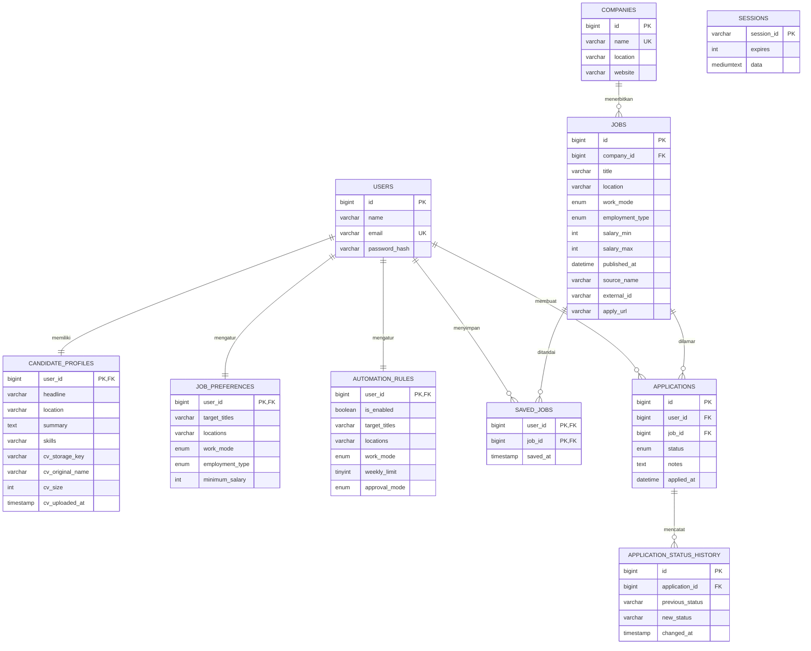

# Dokumentasi Applier Jobes

Dokumen teknis untuk menjalankan, menguji, dan mengembangkan aplikasi. [README.md](../README.md) adalah panduan setup singkat.

## Status implementasi

Yang sudah berjalan dalam aplikasi:

- Halaman terpisah untuk dashboard, pencarian lowongan, lowongan tersimpan, lamaran, pengaturan aturan auto apply, profil, pengaturan akun, login, dan registrasi.
- Daftar lowongan, simpanan, lamaran, dan kecocokan auto apply menggunakan pagination server-side 10 data per halaman; dashboard memiliki navigasi halaman terpisah untuk lowongan dan aktivitas lamaran.
- Autentikasi sesi server dengan penyimpanan sesi di MySQL/MariaDB.
- Hash kata sandi bcrypt, pembatasan percobaan masuk/registrasi, token CSRF untuk semua form yang mengubah data, dan cookie sesi `HttpOnly` serta `SameSite=Lax`.
- Pembuatan akun menyimpan pengguna, profil kosong, preferensi, dan aturan automation secara atomik.
- Pengguna dapat mencari lowongan eksternal tersinkron dan contoh, menyimpan/menghapus bookmark, mencatat draft, meninjau detail dan CV, membuka situs sumber, lalu menandai status setelah pengiriman manual. Perubahan status disimpan di riwayat.
- Preferensi aturan automation dan profil disimpan per pengguna; perubahan kata sandi memerlukan kata sandi saat ini.
- Halaman `/health` menguji koneksi database dan melaporkan status.
- Navigasi mobile memiliki tombol tutup di panel, backdrop yang dapat diklik, tombol Escape, focus trap, penguncian fokus konten di belakang panel, serta pengembalian fokus ke pemicu.

Fitur sumber lowongan mengambil data langsung dari public Job Board API Arbeitnow (lowongan utamanya Eropa) dan dapat menggunakan Adzuna bila API key disediakan. Data dari luar disimpan untuk pencarian, bookmark, dan pipeline; sumber serta tautan asli ditampilkan. CV PDF (maksimal 5 MB) disimpan di luar direktori publik dan hanya diakses melalui route terautentikasi. Asisten apply terpandu mencocokkan aturan pengguna, membuat draft, menyediakan checklist profil/CV, dan membuka situs perusahaan. Pengguna sendiri yang meninjau dan mengirim lamaran; aplikasi **tidak mengisi atau mengirim formulir eksternal secara otomatis**.

Ekstensi browser memindai metadata terstruktur serta kartu lowongan yang sudah dimuat pada tab aktif. Pengguna menerapkan filter sendiri, memilih hingga 50 hasil, lalu meninjau dan mengonfirmasi impor. Ekstensi tidak menavigasi ke halaman lain atau memicu pemuatan konten baru. Struktur situs yang berubah dapat menyebabkan sebagian kartu tidak terdeteksi; dukungan JobStreet belum diverifikasi pada halaman uji nyata.

Belum diimplementasikan: upload DOC/DOCX, integrasi langsung ke akun/job board untuk mengirim lamaran, eksekusi background job, email verifikasi/reset kata sandi, notifikasi persisten, MFA, dan admin panel.

## Arsitektur aplikasi

```text
Browser
  └── Express 4 + Pug templates
       ├── routes/auth.js       registrasi, login, logout
       ├── routes/index.js      halaman aplikasi dan mutasi data
       ├── middleware/auth.js   autentikasi, CSRF, async route handler
       ├── lib/db.js            mysql2 promise pool
       ├── lib/mysql-session-store.js sesi ekspres persisten di MySQL
       ├── lib/job-sources.js  adapter API lowongan dan cache 15 menit
       ├── lib/pagination.js   pagination server-side untuk daftar data
       ├── storage/private/cv  file PDF privat (tidak di-serve sebagai static)
       └── MySQL/MariaDB
            ├── data produk: pengguna, profil/CV privat, lowongan tersinkron, lamaran, aturan
            └── sessions: sesi ekspres serialisasi JSON dengan batas kedaluwarsa
```

Server memakai render HTML di sisi server; JavaScript browser hanya menangani drawer navigasi dan peningkatan interaksi kecil. Daftar utama menggunakan 10 hasil per halaman dengan navigasi URL, menjaga query filter dan memastikan data pengguna tetap dibatasi dengan `user_id` dari sesi terautentikasi.

### Struktur tabel



Schema lengkap dan lowongan contoh berada di [database/schema.sql](../database/schema.sql). Schema dapat dijalankan kembali karena tabel dibuat dengan `IF NOT EXISTS`; seed lowongan mencegah duplikasi berdasarkan perusahaan, jabatan, dan lokasi. Jalankan file ini dengan akun administrator database, bukan akun aplikasi yang memiliki akses terbatas.

### Siklus autentikasi

1. Server membuat token CSRF pada sesi MySQL dan menaruh token tersebut di setiap form.
2. Registrasi memvalidasi nama/email/panjang kata sandi, melakukan hash bcrypt, lalu membuat akun dan data awal di dalam transaksi.
3. Login menggunakan query berparameter dan bcrypt, lalu meregenerasi session ID sebelum menyimpan identitas pengguna di sesi.
4. Middleware halaman aplikasi mengarahkan pengguna yang belum login ke `/login`.
5. Semua POST memeriksa token CSRF dengan perbandingan waktu-konstan.
6. Logout hanya menerima POST, menghapus sesi di MySQL, dan membersihkan cookie.

## Halaman dan endpoint

| Halaman | Method & path | Fungsi |
|---|---|---|
| Beranda | `GET /` | Arahkan ke dashboard atau login sesuai sesi |
| Masuk / daftar | `GET, POST /login`, `GET, POST /register` | Akun dan autentikasi |
| Keluar | `POST /logout` | Hapus sesi |
| Dashboard | `GET /dashboard` | Statistik dari data pengguna dan lowongan |
| Cari lowongan | `GET /jobs?q=&workMode=` | Pencarian lowongan aktif |
| Simpan lowongan | `POST /jobs/:id/save` | Tambah atau hapus saved job |
| Catat lamaran | `POST /jobs/:id/apply` | Buat draft lamaran, bukan submit eksternal |
| Lowongan tersimpan | `GET /saved-jobs` | Lowongan tersimpan milik pengguna |
| Lamaran | `GET /applications` | Pipeline dan status pribadi |
| Tinjau lamaran | `GET /applications/:id/review` | Detail, akses CV pemilik, dan tautan aman ke situs sumber |
| Konfirmasi terkirim | `POST /applications/:id/mark-submitted` | Catat konfirmasi manual dan simpan riwayat |
| Ubah status | `POST /applications/:id/status` | Transaksi update + status history |
| Aturan auto apply | `GET, POST /automation` | Lihat/simpan aturan manual |
| Aktif/jeda aturan | `POST /automation/toggle` | Mengubah status aturan |
| Profil | `GET, POST /profile` | Baca dan simpan profil |
| CV | `POST /profile/cv`, `GET /profile/cv/download`, `POST /profile/cv/delete` | Upload PDF terbatas, akses privat, dan penghapusan |
| Pengaturan | `GET /settings` | Informasi akun |
| Kata sandi | `POST /settings/password` | Ganti kata sandi terautentikasi |
| Cek database | `GET /health` | `{"status":"ok","database":"connected"}` atau error server |

Semua halaman selain login, registrasi, dan health memerlukan sesi yang valid. Semua perubahan menggunakan POST, token CSRF, dan query SQL berparameter.

### Integrasi lowongan dan CV

- Arbeitnow diambil dari `https://www.arbeitnow.com/api/job-board-api?page=1`; provider ini menyediakan lowongan terutama Eropa. Aplikasi menyimpan identitas sumber, URL asli, dan deskripsi teks, lalu menautkan kembali setiap listing ke Arbeitnow.
- Adzuna memerlukan `ADZUNA_APP_ID` dan `ADZUNA_APP_KEY` dari portal developer. Untuk pencarian Indonesia, `.env` memakai `ADZUNA_COUNTRY=id` dan `ADZUNA_LOCATION=Indonesia`; ubah lokasi lewat filter halaman pencarian.
- Respons provider di-cache 15 menit per proses. Kegagalan provider ditampilkan; listing tersimpan tetap tersedia.
- CV hanya menerima PDF hingga 5 MB, memeriksa signature `%PDF-`, memakai nama file acak, dan disimpan di `storage/private/cv/<user-id>/`. File bukan bagian dari direktori static dan setiap unduhan mengecek user ID sesi.
- Untuk database yang telah dibuat sebelum fitur ini, jalankan migrasi administrator satu kali: `/opt/lampp/bin/mysql -u root applier_jobes < migrations/001_live_jobs_and_cv.sql`.
- Semua lamaran eksternal harus dikirim sendiri oleh pengguna pada situs perusahaan; tombol konfirmasi hanya mencatat bahwa pengguna menyatakan telah mengirimnya.

## Navigasi mobile

Pada lebar layar maksimal 900 px, panel navigasi bergeser dari sisi kiri dan menampilkan backdrop. Pengguna dapat menutupnya melalui:

- Tombol **Tutup navigasi** di dalam sidebar.
- Klik backdrop di luar sidebar.
- Tombol `Escape`.
- Memilih halaman lain.

Saat drawer terbuka, konten utama dibuat `inert`, fokus berpindah ke kontrol tutup, fokus keyboard dibatasi di drawer, dan scroll halaman dikunci. Saat drawer ditutup, fokus kembali ke tombol menu. Pada desktop, sidebar tetap terlihat dan drawer tidak mengambil alih fokus.

## Konfigurasi database dan sesi

Variabel konfigurasi dibaca dari `.env` oleh `dotenv`:

| Variabel | Kegunaan |
|---|---|
| `NODE_ENV` | Gunakan `production` pada deployment HTTPS |
| `PORT` | Port HTTP Express, default 3000 |
| `TRUST_PROXY` | Set `true` hanya jika berjalan di belakang reverse proxy tepercaya |
| `DB_HOST`, `DB_PORT` | Alamat MySQL/MariaDB |
| `DB_NAME` | Database aplikasi, default `applier_jobes` |
| `DB_USER`, `DB_PASSWORD` | Akun database aplikasi |
| `SESSION_SECRET` | Rahasia tanda tangan cookie sesi, wajib saat production |

Gunakan akun DB khusus aplikasi. Di lingkungan produksi, batasi hak database sesuai kebutuhan, gunakan TLS untuk koneksi lintas host, atur `TRUST_PROXY` berdasarkan proxy tepercaya, gunakan HTTPS, simpan secret di secret manager, dan sediakan backup. Jangan commit `.env` atau memasukkan rahasia ke Git.

## Validasi dan pemecahan masalah

- Jalankan `npm run check` untuk pemeriksaan syntax route, aplikasi, dan JavaScript browser.
- Jalankan `npm test` untuk pengujian CSRF/auth middleware dan kompilasi/render template.
- Jalankan `npm start`, lalu buka `/health`. Endpoint harus mengembalikan HTTP 200 dan `database: connected`.
- Jika `/health` gagal terhubung, periksa MySQL/MariaDB, nama database, izin user, `DB_HOST`, `DB_PORT`, dan nilai `.env`.
- Jika form mengembalikan 403, muat ulang halaman agar sesi dan token CSRF terbaru digunakan.
- Jika login ditolak, pastikan akun dibuat melalui `/register`; tidak ada kata sandi demo default.
- Jika port 3000 sudah digunakan, ubah `PORT` pada `.env`.
- Sesi hanya berfungsi jika database aktif karena session store menggunakan MySQL; server akan menulis alasan kegagalan ke log.

## Tahapan berikutnya

1. Tambahkan migrasi versi schema dan coverage integration test MySQL.
2. Sediakan unggah CV aman dengan pembatasan ukuran/jenis file dan penyimpanan privat.
3. Tambahkan API sumber lowongan yang penggunaannya diizinkan, deduplikasi, dan skor kecocokan yang transparan.
4. Tambahkan antrean background untuk sinkronisasi; pemrosesan aplikasi tetap memerlukan kontrol dan persetujuan yang eksplisit.
5. Tambahkan verifikasi email, reset kata sandi, MFA, pengelolaan sesi aktif, dan kebijakan retensi/hapus akun.
